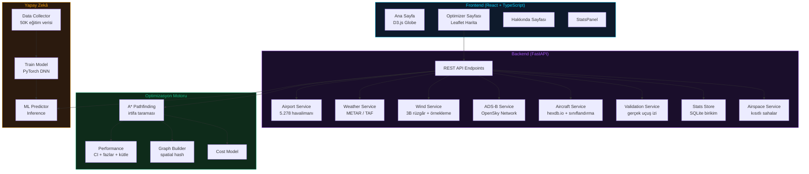

# ✈️ SkyOptimizer AI

**Yapay Zekâ Destekli Uçuş Rota Optimizasyon Sistemi**

> **İnoTürk** ekibi tarafından Deneyap Takımlaşma Projesi kapsamında geliştirilmiştir.
>
> Sivil havacılıkta sabit hava koridorlarının yarattığı zaman ve yakıt kayıplarını minimize etmek için
> ADS-B, canlı meteoroloji ve üst seviye rüzgâr verilerini kullanarak optimum uçuş rotaları hesaplayan
> akıllı bir sistem.

---

## 🌟 Özellikler

| Özellik | Açıklama |
|---------|----------|
| 🛫 **ADS-B Canlı Takip** | OpenSky Network üzerinden gerçek zamanlı uçak pozisyonları; uçak sınıfına göre **SVG ikonlar** ve tıklanınca açılan **uçuş detay paneli** |
| 🌦️ **Meteoroloji Entegrasyonu** | METAR/TAF kartları (VFR→LIFR renk kodu, görüş, rüzgâr, QNH) + NOAA GFS üst seviye rüzgâr |
| 🎚️ **Cost Index** | 0–200 arası hız–yakıt takası (LRC → ECON → HSC); Mach, TAS ve yakıt akışını değiştirir |
| 🛫 **Tırmanma / Seyir / Alçalma** | Yakıt yalnızca cruise'da değil, üç fazda da entegre edilir; kısa rotalarda irtifa otomatik düşer |
| ⚖️ **Azalan Kütle** | Yakıt yandıkça uçak hafifler; yakıt akışı her segmentte güncel kütleyle hesaplanır |
| 🌬️ **3B Rüzgâr + İrtifa Taraması** | FL300 / FL340 / FL390 (300/250/200 hPa) ayrı ayrı optimize edilir, en iyi seviye seçilir |
| 🕐 **Zaman Boyutu** | Kalkış saati seçilir; GFS tahmin saati (`valid_time`) rüzgâra uygulanır |
| ✅ **Gerçek Uçuş Doğrulaması** | Son 12 saatte aynı rotayı uçmuş bir uçağın ADS-B izi, modelle aynı fizikle karşılaştırılır |
| 🤖 **A\* Rota Optimizasyonu** | Spatial-hash graf + A\* ile rüzgâr-optimizasyonlu rota; kısıtlı hava sahalarından kaçınma |
| 🧠 **PyTorch Derin Öğrenme** | 4 gizli katmanlı DNN ile yakıt/süre/CO₂ tahmini (opsiyonel; torch yoksa fizik motoru çalışır) |
| ⛽ **OpenAP Yakıt Modeli** | Uçak tipine özgü drag polar + motor verisiyle fizik tabanlı maliyet |
| 🗺️ **İnteraktif Harita** | Leaflet dark theme + optimize/standart rota, hava sahası katmanı, 150 NM koridor filtresi |
| 🔗 **Paylaşım / Rapor** | Sonuç linki, JSON indirme ve A4 yazdırma raporu |
| 📊 **Dashboard** | Sunucu taraflı (SQLite) birikimli tasarruf + AI vs Fizik karşılaştırma |
| 🌍 **5.278 Havalimanı** | OurAirports veritabanı ile küresel havalimanı desteği |

---

## 🏗️ Mimari



---

## 🚀 Kurulum

### Gereksinimler

- **Python** 3.10+
- **Node.js** 18+
- **NVIDIA GPU** (opsiyonel — CUDA 11.8+ model eğitimi için)

### 1. Repo'yu klonlayın

```bash
git clone https://github.com/<user>/deneyap-takimlasma-proje.git
cd deneyap-takimlasma-proje
```

### 2. Backend kurulumu

```bash
cd backend

# Sanal ortam oluştur
python -m venv venv
.\venv\Scripts\activate    # Windows
# source venv/bin/activate  # macOS/Linux

# Bağımlılıkları kur
pip install -r requirements.txt

# GPU ile model eğitimi (opsiyonel)
pip install torch torchvision --index-url https://download.pytorch.org/whl/cu128
```

### 3. API Anahtarları

Proje kökünde aşağıdaki dosyaları oluşturun:

**`credentials.json`**
```json
{
  "clientId": "YOUR_OPENSKY_CLIENT_ID",
  "clientSecret": "YOUR_OPENSKY_CLIENT_SECRET"
}
```

**`openweatherapi.txt`**
```
YOUR_OPENWEATHERMAP_API_KEY
```

### 4. ML Model eğitimi (opsiyonel)

```bash
cd backend

# Eğitim verisi üret (200.000 satır)
.\venv\Scripts\python ml\data_collector.py

# Model eğit (GPU varsa ~1-2 dk)
.\venv\Scripts\python ml\train_model.py
```

### 5. Frontend kurulumu

```bash
cd frontend
npm install
```

### 6. Çalıştırma

```bash
# Terminal 1 — Backend (port 8000)
cd backend
.\venv\Scripts\python -m uvicorn main:app --reload --port 8000

# Terminal 2 — Frontend (port 5173)
cd frontend
npm run dev
```

Tarayıcıda `http://localhost:5173` adresine gidin.

---

## 📡 API Endpoints

| Method | Endpoint | Açıklama |
|--------|----------|----------|
| `GET` | `/health` | Sistem sağlık kontrolü (sürüm, havalimanı/hava sahası sayısı) |
| `GET` | `/api/status` | API limit ve cache istatistikleri |
| `GET` | `/api/config` | Cost index aralığı, uçak tipleri, varsayılanlar |
| `GET` | `/api/airports/search?q=istanbul` | Havalimanı arama |
| `GET` | `/api/airports/{icao}` | Havalimanı detayı |
| `GET` | `/api/airports/turkey/all` | Tüm Türkiye havalimanları |
| `GET` | `/api/weather/{icao}` | METAR + TAF (görüş, uçuş kategorisi, bulut katmanları) |
| `GET` | `/api/winds?lat=39&lon=35&level_mb=250` | Üst seviye rüzgâr (300/250/200 hPa, Open-Meteo/GFS) |
| `GET` | `/api/airspaces` | Kısıtlı/yasak hava sahaları (GeoJSON + meta) |
| `GET` | `/api/flights/live` | Canlı ADS-B; `lamin/lamax/lomin/lomax` bbox, `enrich` ile uçak kimliği |
| `GET` | `/api/flights/track/{icao24}` | Bir uçağın son ADS-B izi |
| `GET` | `/api/flights/recent?airport=EGLL&hours=12` | Son iniş/kalkışlar (anonim penceresi 12 saat) |
| `GET` | `/api/flights/find?origin=LTFM&destination=EGLL` | Rotayı son uçan gerçek uçuşu bul |
| `GET` | `/api/aircraft/{icao24}?callsign=THY1` | hexdb.io kimliği: tip, tescil, işletmeci, rota |
| `GET` | `/api/traffic` | Türkiye hava sahası trafik özeti |
| `POST` | `/api/optimize` | A* ile optimum rota: `cost_index`, `departure_time`, `avoid_airspace`, `record` |
| `POST` | `/api/validate` | Gerçek uçuş izini aynı fizikle değerlendirip optimize rota ile karşılaştır |
| `POST` | `/api/compare` | Standart vs optimize rota karşılaştır |
| `POST` | `/api/predict` | AI modeli ile yakıt/süre/CO₂ tahmini |
| `GET` | `/api/stats/savings?limit=12` | SQLite'taki birikimli tasarruf toplamları + son kayıtlar |
| `POST` | `/api/stats/savings` | Bir optimizasyon sonucunu birikime kaydet |

---

## 🧠 Optimizasyon Algoritması

### A* Pathfinding

1. İki havalimanı arasında **great-circle** hattı çizilir; antimeridyen (±180°) geçen
   rotalar için boylamlar normalize edilir ve graf üç kopya olarak kurulur.
2. Hat üzerinde **dinamik aralıklı** (~150 NM, 6–48 nokta) waypoint'ler ve ±80 NM
   koridor sapma noktaları eklenir. Örnek sayısı rota uzunluğuna göre ölçeklenir.
3. **NetworkX** grafı spatial-hash ile kurulur (O(n²) komşuluk taraması yok);
   topoloji LRU cache'lenir, kenar maliyetleri her istekte yeniden hesaplanır.
   Ör. LTFM→EGLL ≈ 560 düğüm / ~100 bin kenar, ~0.9 sn.
4. Her kenar için **OpenAP** tabanlı `AircraftPerformance` maliyeti hesaplanır:
   cost index'e göre Mach/TAS, irtifaya göre drag polar, o anki kütleye göre yakıt akışı.
5. **İki rota AYNI graf, AYNI rüzgâr ve AYNI fizik motoruyla** aranır; tek fark hedeftir:
   - **Standart rota** → en kısa mesafe (`distance_nm`)
   - **Optimize rota** → en düşük **kompozit maliyet**: `Yakıt %40 + Süre %35 + CO₂ %25`
6. Her irtifa katmanı (FL300 / FL340 / FL390) için iki rota ayrı ayrı aranır; kompozit
   maliyeti en düşük katman seçilir. Seçim tablosu (`levels`) arayüzde gösterilir.
7. Kompozit maliyet, standart rotanın toplamlarına göre normalize edilir; böylece
   standart rotanın maliyeti tam `1.0` olur ve ağırlık kaydırıcıları gerçekten etki eder.
8. Tasarruf = standart − optimize. Optimize rota **daha uzun ama daha az yakıtlı** olabilir;
   bu durum `distance_delta_nm` ile açıkça raporlanır. Rüzgâr yoksa iki rota çakışır ve
   `has_measurable_savings: false` döner — yapay tasarruf üretilmez. Optimizasyon
   standart rotadan kötü çıkarsa güvenlik ağı devreye girer (`optimization_reverted`).

### Uçuş Fazları, Kütle ve Yakıt

- Tırmanma ve alçalma, 2.000 ft'lik adımlarla integre edilir; toplam mesafe
  havalimanı→havalimanıdır (tırmanma/alçalma mesafesi üstüne eklenmez).
- Yakıt yandıkça kütle azalır; her segment güncel kütleyle hesaplanır (uzun rotada
  %5–10'luk sabit kütle hatası bu şekilde önlenir).
- Yakıt kapasitesi kontrol edilir; menzili yetmeyen uçak tipi `feasible: false` ve
  uyarı ile döner (ör. B738 ile çok uzun trans-Pasifik rota).
- Kısa rotalarda uçak cruise irtifası rota uzunluğuna göre düşürülür.
- Rüzgâr örneklemesi rota boyunca ~150 NM aralıkla, koridorun sol/orta/sağ
  noktalarında yapılır ve seçilen GFS tahmin saatine (`valid_time`) göre alınır.

### PyTorch DNN Modeli

- **Mimari**: 7 → 512 → 256 → 128 → 64 → 3 nöron (LeakyReLU + BatchNorm)
- **Eğitim verisi**: 200.000 örnek (CostModel ile üretilmiş sentetik segment)
- **Not**: Model, fizik motorunun çıktısını taklit eden bir *surrogate* modeldir;
  fizik motorundan daha iyi olduğu iddia edilmez. `/api/predict` iki sonucu yan yana
  ve aradaki sapmayı (`ai_vs_physics_error_percent`) döndürür.
- **Özellikler**: mesafe, rüzgâr hızı/yönü, heading, irtifa, headwind, crosswind
- **Çıktılar**: yakıt (kg), süre (dk), CO₂ (kg)
- **Cihaz**: NVIDIA RTX 4070 (CUDA)

---

## ✅ Gerçek Uçuşla Doğrulama

`POST /api/validate`, son 12 saatte aynı rotayı uçmuş bir uçuşu bulur (OpenSky
iniş listesi + ADS-B izi), uçağın tipini hexdb.io'dan alır ve **gerçek izi aynı fizik
motoruyla** değerlendirir. Ardından aynı rota, aynı kalkış saati rüzgârı ve aynı
ağırlıklarla yeniden optimize edilir.

Dönen sonuç üç sütun içerir: **gerçek** (ADS-B izinden), **optimize** ve **standart**.
Model gerçek uçuştan daha kötü çıkarsa bu gizlenmez; `optimized_is_better: false`
ve gerekçe (`caveats`) gösterilir. Tipik nedenler: ATC yönlendirmesi, gerçek cruise
seviyesinin modelden farklı olması, iniş/kalkış manevraları ve rüzgâr tahmini hatası.

> İz tabanlı yakıt tahmini, yer hızını TAS kabul ettiği için yaklaşık **±%3**
> belirsizlik taşır; sonuç bir kanıt değil, model kalibrasyon aracıdır.

---

## 🧪 Testler

```bash
# Backend — 62 test (ağ erişimi gerekmez)
cd backend
venv/Scripts/python.exe -m pytest tests/ -q

# Frontend — Playwright smoke (API yanıtları mock'lanır, ağ gerekmez)
cd frontend
npx playwright install chromium
npm run test:e2e
```

Backend testleri fizik (fazlar, cost index, kütle azalması, yakıt kapasitesi),
graf/A* (antimeridyen, hava sahası kaçınma, ölçülebilir tasarruf), rüzgâr örnekleme
ve API sözleşmelerini kapsar. Playwright testleri (4 senaryo) optimizasyon sonuçlarının,
uçak ikonlarının/detay panelinin, gerçek uçuş doğrulama kartının ve paylaşım/JSON
akışının uçtan uca çalıştığını doğrular. CI: `.github/workflows/ci.yml` (pytest + build + Playwright).

---

## 📂 Proje Yapısı

```
deneyap-takimlasma-proje/
├── credentials.json              # OpenSky API credentials
├── openweatherapi.txt            # OpenWeatherMap API key
├── README.md
│
├── backend/
│   ├── main.py                   # FastAPI sunucu (v0.3.0)
│   ├── config.py                 # API key yönetimi
│   ├── requirements.txt
│   ├── requirements-dev.txt      # pytest
│   ├── data/
│   │   ├── restricted_airspaces.geojson  # Demo SUA alanları
│   │   └── savings.db            # SQLite birikim (çalışma zamanı)
│   ├── services/
│   │   ├── airport_service.py    # 5.278 havalimanı DB
│   │   ├── route_planner.py      # Ortak optimizasyon hattı
│   │   ├── validation_service.py # Gerçek uçuş doğrulama
│   │   ├── airspace_service.py   # Kısıtlı hava sahası kesişimi
│   │   ├── stats_store.py        # SQLite tasarruf kayıtları
│   │   ├── aircraft_service.py   # hexdb.io kimlik + sınıflandırma
│   │   ├── adsb_service.py       # OpenSky canlı trafik/iz
│   │   ├── weather_service.py    # METAR/TAF
│   │   ├── wind_service.py       # 3B rüzgâr + örnekleme
│   │   └── cache_manager.py      # Cache + rate limiter
│   ├── optimization/
│   │   ├── performance.py        # CI, fazlar, kütle, irtifa seçimi
│   │   ├── graph_builder.py      # Spatial-hash NetworkX graf
│   │   ├── cost_model.py         # Performance adaptörü
│   │   ├── astar.py              # A* + irtifa taraması
│   │   └── ml_predictor.py       # PyTorch inference (lazy)
│   ├── ml/
│   │   ├── data_collector.py     # Eğitim verisi üretici
│   │   ├── train_model.py        # PyTorch DNN eğitimi
│   │   ├── flight_data.csv       # Eğitim verisi
│   │   ├── model.pt              # Eğitilmiş model
│   │   └── scaler.pkl            # Normalizasyon parametreleri
│   ├── tests/
│   │   ├── test_api.py           # API sözleşmeleri
│   │   ├── test_physics.py       # Faz/CI/kütle/fizik
│   │   └── test_routes.py        # Graf, A*, hava sahası
│   └── utils/
│       └── geo.py                # Haversine, bearing, antimeridyen
│
├── .github/workflows/ci.yml      # pytest + build + Playwright
│
└── frontend/
    ├── src/
    │   ├── App.tsx               # React Router
    │   ├── index.css             # Tailwind + cyber-aviation tema
    │   ├── pages/
    │   │   ├── HomePage.tsx      # D3.js globe hero
    │   │   ├── OptimizerPage.tsx # Harita + optimizasyon + rapor
    │   │   └── AboutPage.tsx
    │   ├── lib/
    │   │   └── aircraftIcons.ts  # Sınıfa göre SVG uçak ikonları
    │   ├── services/
    │   │   └── api.ts            # TypeScript API client
    │   └── components/ui/
    │       ├── WeatherCard.tsx
    │       ├── AircraftDetailPanel.tsx
    │       ├── ValidationCard.tsx
    │       ├── StatsPanel.tsx
    │       └── ...
    ├── e2e/                      # Playwright smoke + fixture'lar
    ├── playwright.config.ts
    └── package.json
```

---

## ⚠️ Bilinen Sınırlar

- **OpenSky kimlik bilgileri**: repodaki `credentials.json` geçersizse token isteği 403
döner ve sistem **anonim** moda düşer. Anonim erişimde geçmiş uçuş penceresi
**12 saat**tir; daha uzun doğrulama istekleri reddedilir. Canlı trafik ve 12 saatlik
doğrulama bu modda da çalışır.
- **Kısıtlı hava sahaları**: `restricted_airspaces.geojson` yalnızca 4 örnek FAA
SUA alanı içerir (demo). Gerçek operasyonel kullanım için resmi AIRAC/SUA verisi
`RESTRICTED_AIRSPACE_FILE` ile beslenmelidir.
- **Uçak kimliği**: tip/tescil/işletmeci hexdb.io'ya, sınıflandırma ADS-B emitter
kategorisine ve hız/irtifa sezgisine dayanır. Alçak irtifada jet ile turboprop
ayrımı güvenilir değildir; bilinmeyen tipler `unknown`/`narrow` varsayılır.
- **İz tabanlı yakıt**: yer hızı TAS kabul edilir; rüzgâr düzeltmesi yoktur (~±%3).
- **ATC / hava yolu yapısı**: model serbest koridor varsayar; gerçek seyir yolları,
SID/STAR ve slot kısıtları kapsam dışıdır. Doğrulama sonucu bu yüzden gerçek
uçuştan kötü çıkabilir ve bu durum arayüzde dürüstçe belirtilir.
- **GFS tahmini**: kalkış zamanı verilmezse şimdiki saat kullanılır; çok uzak
gelecek tarihler için tahmin doğruluğu düşer.

---

## 🔧 Teknolojiler

| Katman | Teknoloji |
|--------|-----------|
| Backend | Python, FastAPI, uvicorn |
| Frontend | React 18, TypeScript, Vite, Tailwind CSS 3 |
| Harita | Leaflet, react-leaflet, Esri World Dark Gray (anahtarsız) |
| Optimizasyon | NetworkX, A* pathfinding, OpenAP |
| Yapay Zekâ | PyTorch, CUDA, scikit-learn |
| Veri Kaynakları | OpenSky Network, AviationWeather.gov, Open-Meteo (GFS), OpenWeatherMap (yedek), OurAirports, hexdb.io |
| Kalıcılık | SQLite (`backend/data/savings.db`) |
| Test / CI | pytest, Playwright, GitHub Actions |
| Animasyonlar | D3.js (globe), CSS animations, Lucide icons |

---

## 📋 Proje Bilgisi

<table>
  <tbody>
    <tr>
      <td><strong>Geliştirici Takım</strong></td>
      <td><strong>İnoTürk</strong></td>
    </tr>
    <tr>
      <td><strong>Program</strong></td>
      <td>Deneyap Takımlaşma Projesi 2026</td>
    </tr>
    <tr>
      <td><strong>Lisans</strong></td>
      <td>MIT</td>
    </tr>
  </tbody>
</table>

---

*SkyOptimizer AI — Daha akıllı rotalar, daha az yakıt, daha temiz gökyüzü.* ✈️🌍
